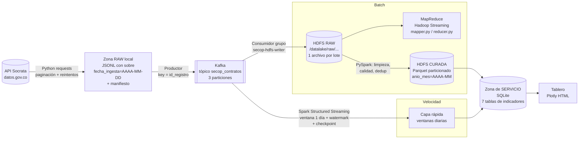

# Pipeline de datos: contratación pública en Antioquia (SECOP II)

Proyecto Pipeline de datos — *De la fuente al tablero*
Gestión de Datos Masivos G002 · Institución Universitaria Pascual Bravo · 2026-2
Integrantes: *Juan Manuel Tejada Bustamante*, *Diego Alejandro Castillo Perez*, *Alejandra Munera* ·

---

## 1. Pregunta, usuarios y fuente

**Pregunta principal:** ¿Qué entidades públicas concentran el valor contratado en Antioquia y qué peso tiene la contratación directa, mes a mes?

**¿Quién usaría los indicadores?** Las veedurías ciudadanas, los periodistas de datos y los entes de control (Contraloría, Personerías). La contratación directa es la modalidad con menos competencia, así que un peso alto o creciente es una señal para revisar.

| Aspecto | Detalle |
|---|---|
| Fuente | SECOP II – Contratos Electrónicos (Colombia Compra Eficiente) en **datos.gov.co** |
| API | Socrata SODA: `https://www.datos.gov.co/resource/jbjy-vk9h.json` (pública, sin clave) |
| Filtro | `departamento = 'Antioquia'`; la fecha inicial se elige automáticamente para tener entre 20.000 y 100.000 contratos |
| Actualización | Diaria: Colombia Compra Eficiente publica contratos nuevos todos los días |
| Columna de fecha | `fecha_de_firma` (tiempo del evento y marca de agua) |
| **id_registro** | `id_contrato` (ej. `CO1.PCCNTR.4515200`): identificador único del contrato en SECOP II |

## 2. Arquitectura: Lambda



| Zona | Herramienta | Ubicación | Formato |
|---|---|---|---|
| Raw (aterrizaje) | Python `requests` | `data/raw/datos.gov.co/secop_contratos/fecha_ingesta=…/` | JSON Lines (sobre) |
| Mensajería | Apache Kafka 3.7 (KRaft, sin Zookeeper) | tópico `secop_contratos`, 3 particiones | JSON |
| Raw (data lake) | HDFS 3.3.6 (pseudo-distribuido) | `/datalake/raw/datos.gov.co/secop_contratos/fecha_ingesta=…/` | JSON Lines |
| Procesamiento batch | MapReduce (Hadoop Streaming) + PySpark 3.5 (modo local) | — | — |
| Curada | PySpark | `/datalake/curada/datos.gov.co/secop_contratos/anio_mes=…/` | Parquet (snappy) |
| Velocidad | Spark Structured Streaming | checkpoint en `/checkpoints/secop_stream_diario` | — |
| Servicio | SQLite | `data/servicio/secop_servicio.db` | tablas SQL + CSV |
| Tablero | Plotly | `dashboard/tablero.html` | HTML |

**¿Por qué Lambda y no Kappa?** La pregunta es histórica (meses completos, ranking de entidades), y para eso hace falta la limpieza completa: deduplicar contra todo lo ya curado, corregir tipos y validar la calidad antes de publicar. Eso es más natural y verificable en batch. Al mismo tiempo, SECOP publica contratos todos los días, así que una capa rápida da conteos diarios sin esperar el batch. Las dos capas se unen en la zona de servicio: la tabla `ind_serie_diaria` usa el batch hasta su fecha de corte y la capa rápida para los días posteriores. Con Kappa tendríamos que reprocesar todo el histórico desde Kafka para cada cambio de lógica, y la retención del tópico no está pensada para ser el almacenamiento histórico.

## 3. Estructura del repositorio

```
├── notebooks/Pipeline_SECOP_Antioquia_Colab.ipynb   # TODO el pipeline (fases 1 a 8), ejecutado, con explicaciones
├── mapreduce/mapper.py, reducer.py                  # job MapReduce (Hadoop Streaming)
├── requirements.txt
├── data/
│   ├── muestras/raw_muestra.jsonl                   # muestra de la zona raw (500 registros)
│   ├── manifiestos/                                 # un manifiesto por ejecución de la ingesta
│   └── servicio/                                    # secop_servicio.db (SQLite) + CSV de cada tabla
├── estado/                                          # marca de agua y registros de control
├── evidencias/                                      # Kafka, HDFS, MapReduce vs Spark, calidad, idempotencia, streaming
├── dashboard/tablero.html                           # tablero (se abre con doble clic)
└── docs/guion_sustentacion.md
```

## 4. Cómo ejecutar (Google Colab)

1. Abrir `notebooks/Pipeline_SECOP_Antioquia_Colab.ipynb` en Google Colab (Archivo → Subir notebook).
2. `Entorno de ejecución → Ejecutar todas`. La primera ejecución tarda unos 15–20 minutos:
   - instala Java 11/17, PySpark, kafka-python y Plotly;
   - descarga **Hadoop 3.3.6** y **Kafka 3.7.0** de los servidores de Apache;
   - levanta **HDFS pseudo-distribuido** (NameNode + DataNode, `hdfs://localhost:9000`) y **Kafka en modo KRaft** (`localhost:9092`) dentro de la máquina de Colab;
   - corre las fases 2 a 8, la demostración del fallo de calidad, el reinicio del streaming y una **segunda corrida completa** para demostrar la idempotencia.
3. La última celda descarga `resultados_pipeline.zip`, con las evidencias, los datos de servicio y el tablero, que se suben a este repositorio.

Cada fase es una función (`ingestar()`, `producir()`, `consumir_a_hdfs()`, `correr_mapreduce()`, `curar()`, `correr_streaming()`, `construir_servicio()`, `construir_tablero()`), y `pipeline_completo(etiqueta)` las corre todas en orden.

## Resultados (corrida del 24 de noviembre de 2026)

**Respuesta a la pregunta:** en Antioquia, **79 % de los contratos públicos se firmaron por contratación directa**, y el **Distrito de Medellín concentra el 30 % del valor contratado**. Las 5 entidades con más valor suman el 57 %.

| Indicador | Valor |
|---|---|
| Contratos analizados | **55.963** (firmados del 2 de marzo al 22 de noviembre de 2026, fecha de corte) |
| Valor total contratado | **$11,64 billones** COP |
| % de contratos por contratación directa | **79,4 %** (45,7 % del valor en "Contratación directa" + 15,7 % en "directa con ofertas") |
| Entidades contratantes / municipios | 485 / 113 |
| Entidad con más valor | Distrito Especial de Ciencia, Tecnología e Innovación de Medellín: $3,50 billones (30,1 %) |
| Entidades con más contratos directos | Institución Universitaria ITM (10.140 contratos, 98,8 % directa) e INDER Medellín (4.163, 96,8 %) |

**Hallazgo: el efecto de la Ley de Garantías.** Entre marzo y mayo de 2026 solo entre el 10 % y el 14 % de los contratos fueron directos, y se firmaban entre 1.360 y 1.730 contratos al mes. En julio la proporción subió al **91 %**, con **15.768 contratos** en un solo mes. Coincide con la Ley 996 de 2005 (Ley de Garantías), que prohibió la contratación directa desde el 31 de enero de 2026 hasta la segunda vuelta presidencial del 21 de junio. Las entidades represaron esa contratación y la firmaron apenas se levantó la restricción.

| Evidencia técnica | Resultado |
|---|---|
| Ingesta | 12 páginas de 5.000, 0 reintentos, 55.963 registros, 0 sin id |
| Kafka | 3 particiones: 18.752 / 18.611 / 18.600 mensajes; lag del grupo = 0 |
| HDFS | 6 lotes (archivos) de hasta 10.000 mensajes, no 55.963 archivos |
| MapReduce vs Spark | 13 modalidades, conteo y valor idénticos (55.963 registros) |
| JSONL vs Parquet | 91,9 MB → 9,35 MB (**89,8 % menos**), 9 particiones `anio_mes` |
| Calidad | 7 validaciones OK; con 5 duplicados inyectados el pipeline se detuvo y la curada no cambió |
| Idempotencia | Corrida 2: la marca de agua trajo 1 registro de traslape (raw 55.964), y la curada se mantuvo en 55.963 = ids distintos |
| Streaming | 55.963 mensajes → 252 ventanas diarias cerradas; al reiniciar leyó **0 mensajes** y los conteos no cambiaron |

## 5. Fases y decisiones

### Fase 2 · Ingesta a la zona raw (función `ingestar()`)
- **Paginación** con `$limit=5000` y `$offset`, con orden estable `fecha_de_firma, id_contrato`. Sin un orden fijo, Socrata puede repetir u omitir filas entre páginas.
- **Reintentos**: 5 intentos con espera exponencial (2, 4, 8, 16 s) ante errores de conexión, timeouts, HTTP 429 (límite de peticiones) y 5xx. Un 4xx distinto de 429 es un error de la consulta, así que no se reintenta.
- **Sobre JSON**: `{fuente, dataset, id_registro, fecha_ingesta, run_id, payload}`, donde `payload` es el registro tal como lo devolvió la API, sin modificar.
- **Particionado** por `fecha_ingesta=AAAA-MM-DD`, con un archivo por ejecución (`part-<run_id>.jsonl`).
- **Manifiesto** por ejecución en `data/manifiestos/`, con la URL, los parámetros, las páginas, el conteo, los reintentos y la marca de agua anterior y nueva.
- **Minimización de datos**: con `$select` se piden 32 columnas y se excluyen los datos personales que no aportan a la pregunta (cuentas bancarias y documentos de representantes legales, supervisores y ordenadores del gasto). Los valores que sí se piden se guardan intactos.

### Fase 3 · Kafka (funciones `producir()` y `consumir_a_hdfs()`)
- El tópico `secop_contratos` tiene **3 particiones**. Cada mensaje lleva **key = id_registro**, así que el mismo contrato siempre cae en la misma partición y conserva su orden.
- Productor con `acks=all`, reintentos y `max_in_flight=1`, para que un reintento no desordene ni pierda mensajes.
- Consumidor con el grupo `secop-hdfs-writer` y `enable_auto_commit=False`: el offset se confirma solo después de escribir el lote en HDFS (entrega *al menos una vez*).
- **¿Qué pasa si el productor corre dos veces?** Kafka no deduplica por key, así que cada contrato quedaría dos veces en el tópico. Lo evitamos así:
  1. El productor solo publica archivos raw que no ha publicado antes (`estado/productor_archivos_publicados.json`).
  2. El consumidor continúa desde su offset confirmado, sin releer.
  3. Si igual llega un duplicado (por ejemplo con `--forzar`, o por el traslape de la marca de agua), la zona curada **deduplica por id_registro**.

### Fase 4 · HDFS y MapReduce (`consumir_a_hdfs()`, `mapreduce/`, `correr_mapreduce()`, `comparar_mr_spark()`)
- Ruta: `/datalake/raw/datos.gov.co/secop_contratos/fecha_ingesta=…/lote_….jsonl`, con **un archivo por lote** de hasta 10.000 mensajes. Muchos archivos pequeños saturarían la memoria del NameNode.
- **MapReduce** (Hadoop Streaming, mapper y reducer en Python): cuenta los contratos y suma el valor por modalidad de contratación sobre el raw.
- **Spark** hace el mismo cálculo con las mismas reglas (modalidad vacía → `SIN_DATO`, valor no numérico → 0, redondeo HALF_UP). `evidencias/mapreduce_vs_spark.csv` muestra que coinciden fila a fila.

### Fase 5 · Zona curada (función `curar()`)
| Problema | Decisión | Por qué |
|---|---|---|
| Líneas JSON corruptas | Se descartan | No hay datos recuperables |
| Sin `id_registro` | Se descartan | No se pueden deduplicar ni rastrear |
| Duplicados por `id_registro` | Se conserva la versión más reciente (`ultima_actualizacion`, luego `fecha_ingesta`) | Vienen del traslape de la marca de agua y de los reenvíos de Kafka |
| Texto inconsistente (`terminado` / `Terminado`, espacios, `No definido`, `Sin Descripcion`) | trim, un solo espacio, formato Título; los marcadores pasan a nulo | Así una categoría no se cuenta dos veces y "No definido" no se toma como un valor real |
| Tipos (todo llega como texto) | Fechas a timestamp/date, valores a `decimal(20,2)`, días a int | Permite sumar, filtrar y particionar por fecha |
| Sin `fecha_de_firma` | Se descarta | Es la columna de tiempo del análisis |
| Fecha fuera de [2015, hoy] | Se descarta | SECOP II existe desde 2015; una fecha futura es un error |
| Valor nulo | **Se conserva como nulo** | Imputar 0 bajaría los promedios; el contrato cuenta en los conteos, no en las sumas |
| Valor negativo | Se descarta | Un contrato no puede valer menos de cero |

- `evidencias/curada_pasos_ultimo.csv` guarda las **filas antes y después** de cada paso, y `curada_formatos_ultimo.csv` los valores distintos antes y después de normalizar.
- **Partición por `anio_mes`**: la pregunta y el tablero son mensuales, y las cargas incrementales solo tocan los meses nuevos. Se descartó `ciudad` (125 municipios con mucho sesgo: Medellín tendría la mayoría y muchos municipios quedarían con archivos diminutos) y `fecha` diaria (cientos de particiones pequeñas).
- **Tamaño**: `evidencias/tamanos_jsonl_vs_parquet.json` compara el JSONL raw con el Parquet curado. El Parquet es columnar y comprimido (snappy), y no repite los nombres de las columnas en cada registro como hace el JSON, así que ocupa una fracción del JSONL.

### Fase 6 · Calidad, incremental e idempotencia (funciones `validar()`, `curar()`, `conteos()`)
- **7 validaciones automáticas**. Son 5 críticas: conteo > 0, sin nulos en `id_registro`/`fecha_de_firma`/`anio_mes`, sin `id_registro` repetidos, fecha en rango y valor no negativo. Las otras 2 son advertencias: valor nulo < 5 % y departamento = Antioquia.
- **Reporte** en `evidencias/calidad/reporte_calidad_<run>.json`, con los descartados por motivo, más un historial en `historial_calidad.csv`.
- **Si una crítica falla, el pipeline se detiene** (código 2) y la zona curada no se toca. Se demuestra en el notebook con `curar(completo=True, simular_fallo=True)`.
- **Marca de agua**: `estado/watermark.json` guarda la última `fecha_de_firma` cargada, y la siguiente ingesta solo pide `fecha_de_firma >= marca`. Se usa `>=` para no perder contratos firmados en el mismo instante; el traslape se elimina con el dedup.
- **Incremental en la curada**: solo se procesan los archivos raw nuevos, que se unen con lo ya curado de esos meses, se deduplican y reemplazan solo esas particiones (sobrescritura dinámica).
- **Idempotencia**: `evidencias/idempotencia_conteos.csv` registra los conteos de cada corrida. En la segunda corrida `curada_filas` y `curada_ids_distintos` no cambian, salvo por contratos realmente nuevos.

### Fase 7 · Streaming (función `correr_streaming()`)
- Structured Streaming lee el tópico de Kafka y calcula, por **ventana de 1 día** de `fecha_de_firma`, los contratos, los contratos únicos, los de contratación directa y el valor.
- **Watermark de 3 días**: una ventana se cierra y se emite (modo append) cuando ya pasaron 3 días de tiempo de evento. Los eventos más tardíos se descartan, y así el estado no crece sin límite.
- **Checkpoint en HDFS** (`/checkpoints/secop_stream_diario`): guarda los offsets y el estado. Al reiniciar se leen 0 mensajes y los conteos de SQLite no cambian (`evidencias/streaming_reinicio.csv`).
- El sink `foreachBatch` escribe en SQLite con `INSERT OR REPLACE` por ventana, así que reintentar un micro-lote no duplica.
- **Unión con el batch**: está explicada en la sección 2 (Lambda) y se implementa en la tabla `ind_serie_diaria`.

### Fase 8 · Servicio y tablero (funciones `construir_servicio()` y `construir_tablero()`)
- **Tablas en SQLite**: `ind_resumen`, `ind_mensual`, `ind_top_entidades`, `ind_modalidad`, `ind_municipios`, `ind_serie_diaria` y `metadata`. Todo llega precalculado.
- **El tablero tiene 5 visualizaciones y 5 KPIs.** Su título responde la pregunta con los datos, y el pie de página dice la fuente y la fecha de corte.

## 6. Evidencias (`evidencias/`)
| Evidencia | Archivo |
|---|---|
| Tópico Kafka (3 particiones) y grupo consumidor | `kafka_topico_describe.txt`, `kafka_grupo_consumidor.txt`, `kafka_productor_ultimo.json` |
| HDFS `hdfs dfs -ls` | `hdfs_ls_raw.txt`, `hdfs_ls_datalake.txt`, `hdfs_du_zonas.txt` |
| MapReduce vs Spark | `mapreduce_resultado.tsv`, `mapreduce_vs_spark.csv` |
| Limpieza antes/después | `curada_pasos_ultimo.csv`, `curada_formatos_ultimo.csv`, `esquema_curado.txt` |
| JSONL vs Parquet | `tamanos_jsonl_vs_parquet.json` |
| Calidad | `calidad/reporte_calidad_ultimo.json`, `calidad/historial_calidad.csv` |
| Idempotencia (2 corridas) | `idempotencia_conteos.csv` |
| Streaming tras reiniciar | `streaming_reinicio.csv`, `hdfs_checkpoint_streaming.txt` |

## 7. Problemas comunes
- **Colab se desconecta:** HDFS y Kafka viven en la máquina de Colab y se pierden. Hay que volver a `Ejecutar todas`.
- **La descarga de Hadoop o Kafka falla:** volver a ejecutar la celda de instalación, que prueba dos servidores de Apache.
- **El streaming tarda la primera vez:** Spark descarga el conector de Kafka desde Maven (~1 min).
- **La API responde 429:** esperar un minuto (hay reintentos automáticos) o usar un *app token* gratuito de datos.gov.co.
